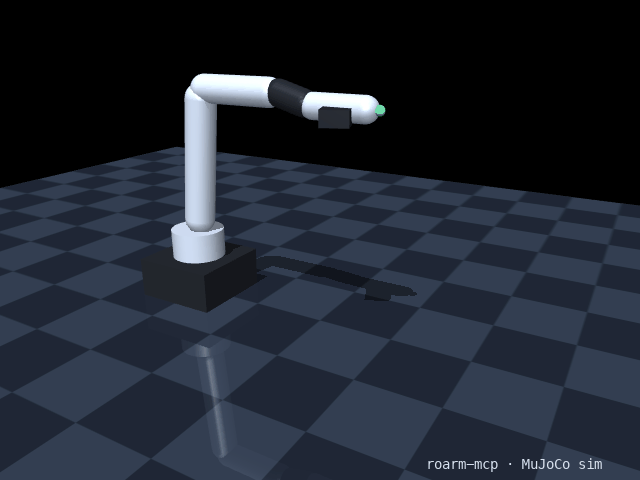

# roarm-mcp

[](https://pypi.org/project/roarm-mcp/)
[](https://github.com/SamKo88927/roarm-mcp/actions/workflows/ci.yml)
[](LICENSE)
[](https://glama.ai/mcp/servers/SamKo88927/roarm-mcp)

<!-- mcp-name: io.github.SamKo88927/roarm-mcp -->

An [MCP](https://modelcontextprotocol.io) server that lets LLM agents drive a
[Waveshare RoArm-M3](https://www.waveshare.com/wiki/RoArm-M3) desk arm, with a safety layer the agent cannot bypass.

<p align="center">
  
</p>

<sub>Every frame comes from the same `Arm`, safety layer and simulator the MCP server uses
(`uv run --extra render python scripts/record_demo.py docs/media/demo.gif`). Refused targets turn red, and the
out-of-reach refusal carries a suggested safe pose that the next call follows. The arm in the GIF is drawn with
meshes split from Waveshare's official RoArm-M3 STEP file (`--meshes`); those meshes are not in this repository,
and without them the simulator draws a box-and-cylinder shell.</sub>

- **Simulation first.** The arm runs in MuJoCo. No hardware is needed to try it.
- **Safety below the agent.** Every motion is planned into joint waypoints, and every waypoint is checked
  (joint limits, self-collision, arm-table collision, clearance of every link and of the tool tip) before
  anything moves. A monitor then checks what actually ran and halts the arm if it leaves the envelope.
- **Refusals a model can use.** A refused command returns a reason code, a message and, when one exists, the
  farthest checked-safe pose toward the target, so the model can correct itself instead of retrying blindly.

> **Status: 0.1 runs in simulation.** A USB-serial transport for the real arm (`--real`) is on `main` and tested
> against a fake firmware, but has not been run on hardware yet, and is not in a PyPI release. Use `--dry-run` to see
> the commands it would send.

## Quick start

Requires Python 3.11+ and [uv](https://docs.astral.sh/uv/). No clone needed:

```sh
uvx roarm-mcp --help
```

### Claude Code

```sh
claude mcp add roarm -- uvx roarm-mcp
```

### Claude Desktop and other MCP clients

```json
{
  "mcpServers": {
    "roarm": {
      "command": "uvx",
      "args": ["roarm-mcp"]
    }
  }
}
```

### Options

| Flag | Effect |
| --- | --- |
| `--trace FILE` | Append every tool call, its arguments and its verdict to a JSONL file |
| `--http` | Serve streamable HTTP on `--host`/`--port` (default `127.0.0.1:8000`) instead of stdio |
| `--allow-remote` | Required for a non-loopback `--host`. The HTTP endpoint has no authentication |
| `--fast` | Run the simulation faster than real time |
| `--real DEVICE` | Drive the real arm on a serial device such as `/dev/cu.usbserial-XXXX` (`pip install 'roarm-mcp[real]'`). Unverified on hardware |
| `--dry-run` | With `--real`: talk to a fake arm and print every command that would be sent |
| `--gripper-map FILE` | With `--real`: `{"raw_closed": ..., "raw_open": ...}` measured on your claw, in firmware radians |
| `--stock-gripper` | With `--real`: the arm has the stock claw. `--real` needs this or `--gripper-map` |
| `--min-clearance-mm` | Smallest allowed arm-to-table distance. Default 15 in simulation, 60 with `--real`, because the model does not know about tools or cameras you fitted |
| `--log-level` | `DEBUG` to `ERROR`. Logs go to stderr only, so stdio stays clean |

Then ask, for example: *"Check the limits, then move the gripper to 40 mm above the table at x=220, y=80."*

## Tools

Coordinates are millimetres in the table frame: x forward, y left, z = height of the tool centre point above the
table. Angles are degrees.

| Tool | What it does |
| --- | --- |
| `get_state` | Tool pose, joint angles, gripper opening, lowest clearance above the table, whether a motion is running |
| `get_limits` | The active safety envelope. Fixed at startup; no tool can change it |
| `move_to(x_mm, y_mm, z_mm, pitch_deg=90, roll_deg=0, speed=0.5)` | Move the tool centre point. `pitch_deg` 90 = pointing straight down |
| `move_joints(joints_deg, speed=0.5)` | Move the five arm joints |
| `gripper(opening, speed=0.5)` | 0 = closed, 1 = fully open |
| `rest(speed=0.5)` | Return to the rest pose |
| `stop()` | Halt the running motion at the next waypoint. Software stop only |

Resources: `roarm://limits` and `roarm://trace/latest` (the last 50 tool calls with their verdicts).

A refused call returns `isError: true` with structured content like:

```json
{
  "ok": false,
  "refusal": {
    "code": "TABLE_CLEARANCE",
    "message": "target z is 0 mm; the tool must stay at least 18 mm above the table",
    "details": {"z_mm": 0.0},
    "suggestion": {"x_mm": 220.3, "y_mm": 79.9, "z_mm": 18.0, "pitch_deg": 89.9, "roll_deg": 0.0,
                   "note": "farthest checked-safe pose on the straight line toward the target (55% of the way)"}
  }
}
```

Refusal codes: `OUT_OF_REACH`, `TOO_CLOSE`, `TOO_HIGH`, `TABLE_CLEARANCE`, `TABLE_COLLISION`, `SELF_COLLISION`,
`JOINT_LIMIT`, `UNREACHABLE` (no joint solution within tolerance), `BAD_TARGET`, `BAD_JOINTS`, `BAD_GRIPPER`,
`BUSY`, `STOPPED`, `ENVELOPE_BREACH`, `INTERNAL_ERROR` (a fault inside the server; logged and traced, and the arm
is free for the next call).

## Safety model

```
agent ──► MCP tool ──► plan (IK, joint-space waypoints)
                         │
                         ▼
                 check every waypoint ── refuse with reason + safe suggestion
                         │
                         ▼
                 transport.follow ──► monitor what actually ran ── halt on breach
```

Details and the default numbers are in [docs/safety.md](docs/safety.md). In short:

- The envelope is a frozen value object, built once at startup. The MCP surface has no tool that can widen it.
- Inverse kinematics never returns a non-converged answer as a plan; a miss beyond 1 mm or about 1° is a refusal.
- The checked waypoints are the exact waypoints the transport follows.
- `stop()` is a software stop. On real hardware, the physical power switch is the only real emergency stop.

## Development

```sh
git clone https://github.com/SamKo88927/roarm-mcp && cd roarm-mcp
uv sync
uv run ruff check . && uv run ruff format --check .
uv run pyright          # strict
uv run pytest -q --cov=roarm_mcp
```

The tests include property-based tests (Hypothesis) that send random targets and joint sets, including far
outside the workspace, and check the clearance measured on the stepped simulation rather than only on the plan. A
guard test fails the suite if too few of those random commands actually moved the arm.

## Limitations

- The real-arm transport is unverified on hardware. It opens the gripper but refuses to close it: there is no
  contact detection or firmware torque limit yet. Camera tools and pick/place skills are not written yet.
- The simulated arm is built from boxes and cylinders on the arm's kinematic tree: a visual shell in the arm's
  colours, and hidden capsules and boxes for collision. No vendor meshes or CAD files are shipped; the demo
  script can draw the arm with your own copy (`scripts/record_demo.py --meshes`).
- The minimum clearance is checked against the table plane only. Objects on the table are not modelled yet.
- The simulation holds joints against gravity like stiff position servos. Real servos sag and lag more; the
  real-arm milestone adds measured margins.

## Roadmap

1. Real arm over USB serial and Wi-Fi, with every motion checked in MuJoCo first.
2. Camera tools: `look` returns a frame to a multimodal model, `locate` maps a chosen pixel to table coordinates.
3. Pick and place skills.
4. A reproducible benchmark that compares how well different models operate the arm.

Contributions are welcome; see [CONTRIBUTING.md](CONTRIBUTING.md). Report security issues as described in
[SECURITY.md](SECURITY.md).

## License

Apache-2.0. This project is not affiliated with Waveshare.
